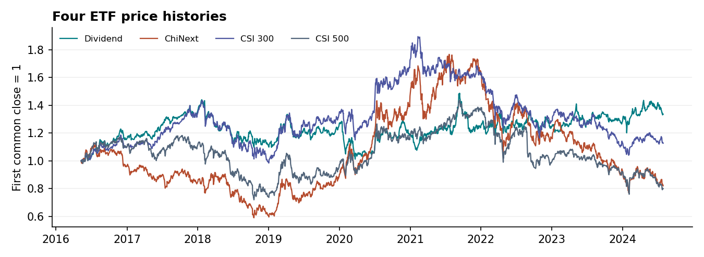

# Momentum across four ETFs

Which fund leads when momentum rewards a steady trend?

This replication follows four Chinese equity ETFs covering dividends, ChiNext, the CSI 300 and the CSI 500. One signal ranks trailing price changes. A second fits a line to 25 normalized closing prices and weights its slope by the regression R². The allocation signal is lagged before measuring subsequent returns.

The example exposes the trend scorer from the notebook and evaluates it on a rising price series. The full historical experiment used daily Tushare fund prices. The notebook credits the [original rotation study](https://zhuanlan.zhihu.com/p/646860740).

## Run the example

From this project directory, using Python 3.12 in a virtual environment:

```sh
python -m pip install -r requirements.txt
python example.py
```

The [backtest driver](rotation.py) accepts a sorted daily price panel. It applies yesterday’s winning fund to today’s return. Both the 21-session price-change rule and the 25-session trend rule were replayed on the archived four-fund workbook (2,001 daily rows). Run `python rotation.py closes.csv --method trend` with a date column and one closing-price column per fund. Returns exclude trading costs.



## Original research code

The source notebook follows the experiment from daily fund quotes to cross-sectional scores and lagged portfolio returns. It retains the original study attribution and its working notes. To fetch data, supply a Tushare token through the `TUSHARE_TOKEN` environment variable. The standalone example runs offline.

[Browse the research source](research-source/) · [GitHub profile](https://github.com/BarryGreenton)
